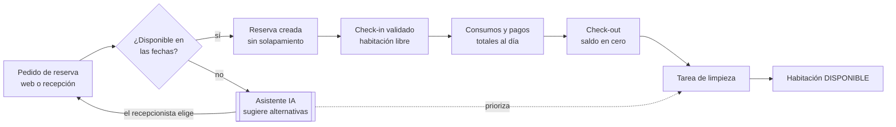
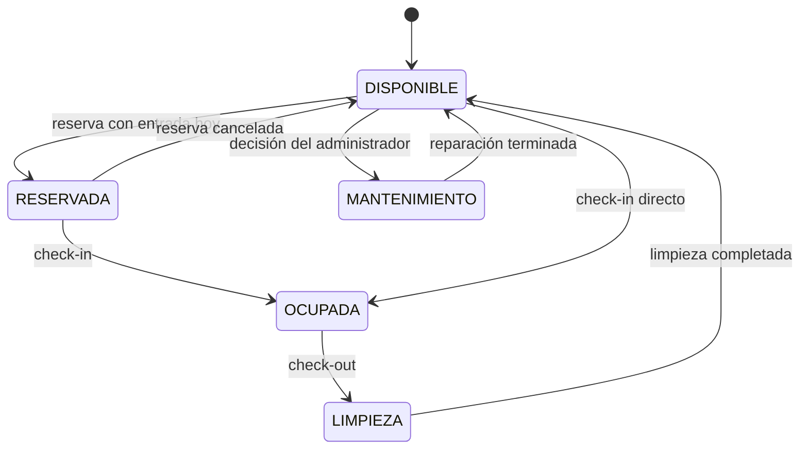
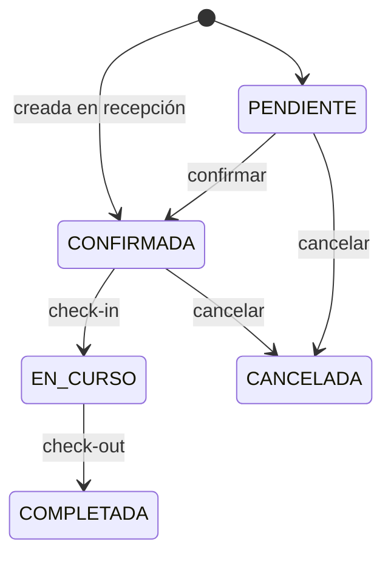
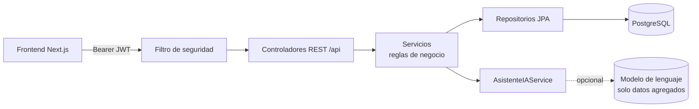

# Modelo TO-BE — Sistema Hotel Princes Ica

Issue: HPI-03 · Sprint S1 · Rama `docs/diseno-tobe`

En el TO-BE cada operación se valida en el backend antes de cambiar el estado de una habitación, y un asistente de IA apoya dos decisiones sin ejecutar nada por sí mismo.

## 1. Flujo de la estancia

## 2. Estados de la habitación

Reglas: una habitación OCUPADA, en LIMPIEZA o en MANTENIMIENTO no admite check-in; una reserva no puede pisar el estado OCUPADA.

## 3. Estados de la reserva

## 4. Cambios por proceso

| Proceso | AS-IS | TO-BE |
| --- | --- | --- |
| Inicio de sesión | Backend o lista fija en el navegador | Token JWT del backend; sin contraseñas en el cliente |
| Reserva | Sin control de fechas; precio enviado por el cliente | Valida solapamiento y capacidad; precio = noches × tarifa |
| Check-in | Permite doble check-in y habitación ocupada | Valida estado de reserva y habitación |
| Pagos y consumos | Editables tras el check-out | Bloqueados al cerrar la estadía |
| Limpieza | ALTA queda al final | Orden real por prioridad, con sugerencia de IA |
| Reportes | Datos de prueba del navegador | Datos de la API |
| Errores | Se ocultan y se simula éxito | Mensaje del servidor visible |

## 5. Roles y permisos

| Rol | Puede | No puede |
| --- | --- | --- |
| ADMINISTRADOR | Todo, incluida la gestión de usuarios | — |
| GERENTE | Dashboard, reportes, transacciones, resumen IA | Gestionar usuarios |
| RECEPCIONISTA | Reservas, huéspedes, check-in/out, consumos, pagos, recomendador IA | Eliminar pagos, gestionar usuarios |
| LIMPIEZA | Ver, iniciar y completar tareas de limpieza | Reservas, pagos, reportes |

## 6. Arquitectura

## 7. Asistente de IA

| Función | Endpoint | Usuario | Resultado | Control humano |
| --- | --- | --- | --- | --- |
| Recomendador de habitación | `POST /api/asistente/recomendar` | Recepción | Hasta 3 habitaciones libres con su motivo | El recepcionista elige y reserva |
| Resumen diario | `GET /api/asistente/resumen-diario` | Gerente | Párrafo con ocupación, ingresos y alertas | Solo lectura |
| Priorización de limpieza | `GET /api/asistente/limpieza-priorizada` | Limpieza | Orden sugerido de tareas | El supervisor acepta o cambia |

- Las opciones siempre salen de la base de datos con reglas fijas; el modelo solo redacta la explicación.
- La IA es Llama (modelo libre) vía Groq u Ollama (`IA_PROVEEDOR`); sin IA, el asistente responde solo con reglas.
- Al modelo no se envían nombres, documentos ni teléfonos de huéspedes.
