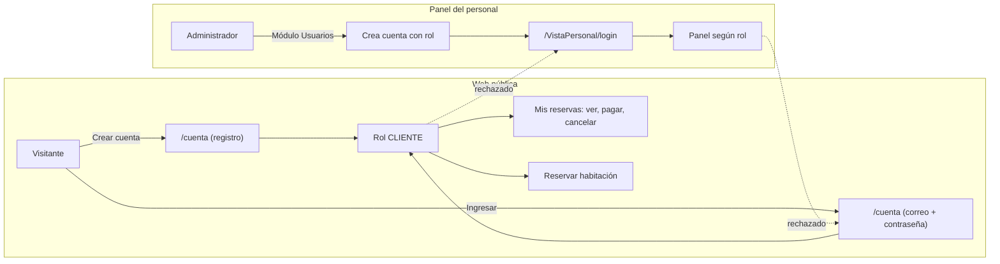

# Versión 2: clientes, personal, validaciones y nueva web

Issues HPI-19 a HPI-24 · Ramas 19 a 24 · RF-17 a RF-20

## Qué cambió

| # | Rama | Qué hace |
| --- | --- | --- |
| 19 | `feature/cuentas-clientes` | Rol `CLIENTE`, registro e ingreso propios en `/cuenta`, "Mis reservas" (ver, pagar, cancelar) y reserva solo con cuenta. Se elimina la reserva anónima. |
| 20 | `feature/usuarios-personal` | Sin registro de trabajadores. Módulo **Usuarios** del administrador: alta, rol, turno, activación y restablecimiento de contraseña. Siempre queda un administrador activo. |
| 21 | `fix/mercadopago-credenciales` | Acepta credenciales de prueba `APP_USR-` con `MP_MODO=prueba`. |
| 22 | `feature/web-publica-ux` | Banner con el nombre del hotel, buscador por fechas, disponibilidad real y total de la estadía, pasos para reservar. |
| 23 | `feature/validacion-reservas` | Reglas de documento, celular, nombres, contraseña, fechas y noches en el servidor y en los formularios, con el error junto a cada campo. |
| 24 | `docs/version-2` | Este documento, requisitos RF-17 a RF-20 y README. |

## Dos ingresos separados

- Un cliente que intenta entrar al panel recibe: "Esta cuenta es de cliente. Ingrese desde la web del hotel".
- Un trabajador que intenta entrar como cliente recibe: "Esta cuenta es del personal del hotel".
- Las sesiones se guardan aparte en el navegador: el personal puede probar la web sin cerrar su sesión del panel.
- El API protege `/api/cliente/**` con el rol `CLIENTE`; el resto del API sigue exigiendo roles del personal.

## Reglas de validación

| Dato | Regla |
| --- | --- |
| Nombres y apellidos | Solo letras, espacios, apóstrofo y guion; 2 a 80 caracteres |
| DNI | 8 dígitos |
| Carné de extranjería | 9 a 12 letras o números |
| Pasaporte | 6 a 12 letras o números |
| RUC (solo panel) | 11 dígitos que empiezan con 10, 15, 17 o 20 |
| Celular | 9 dígitos que empiezan con 9, o internacional con `+` y código |
| Correo | Formato válido, máximo 50 caracteres (es el usuario del cliente) |
| Contraseña del cliente | Mínimo 8 caracteres con letras y números |
| Fechas de una reserva web | Llegada desde hoy y hasta un año; salida al menos un día después; máximo 30 noches |
| Personas | De 1 a la capacidad de la habitación |
| Pedidos especiales | Máximo 300 caracteres |

Si el documento ya existe porque el huésped se alojó antes, la cuenta se vincula a su ficha solo si los apellidos coinciden.

## Casos de prueba nuevos

| ID | RF | Prueba | Resultado esperado |
| --- | --- | --- | --- |
| CP-23 | RF-17 | En `/cuenta` crear una cuenta con DNI de 8 dígitos y contraseña con letras y números | Entra directo a "Mis reservas" |
| CP-24 | RF-20 | Registrar con DNI de 7 dígitos o contraseña sin números | El error aparece debajo del campo y no se crea la cuenta |
| CP-25 | RF-17 | Ingresar a `/cuenta` con `admin` / `admin123` | "Esta cuenta es del personal del hotel" |
| CP-26 | RF-07 | Ingresar a `/VistaPersonal/login` con `cliente@demo.com` / `cliente123` | "Esta cuenta es de cliente" |
| CP-27 | RF-19 | En la web buscar 2 noches para 2 personas | Lista con "Disponible" u "Ocupada en esas fechas" y el total de 2 noches |
| CP-28 | RF-17 | Sin sesión, pulsar Reservar | Pide ingresar; al ingresar vuelve a la misma habitación y fechas |
| CP-29 | RF-20 | En el formulario de reserva elegir 31 noches | Aviso "Máximo 30 noches" y botón deshabilitado |
| CP-30 | RF-03 | Reservar y pulsar "Pagar ahora con Mercado Pago" con el comprador de prueba | Vuelve a "Pago aprobado"; en "Mis reservas" figura lo pagado |
| CP-31 | RF-17 | Cancelar una reserva futura sin pago desde "Mis reservas" | Estado "Cancelada" y la habitación vuelve a quedar libre en esas fechas |
| CP-32 | RF-18 | Como admin, en Usuarios crear `jperez` con rol Limpieza; luego desactivarlo | `jperez` entra al módulo Limpieza; desactivado ya no puede ingresar |
| CP-33 | RF-18 | Intentar desactivar al único administrador o a uno mismo | Se rechaza con el motivo |

## Pruebas automáticas nuevas

`ClienteCuentaServiceTest` (5), `UsuarioServiceImplTest` (4), `DisponibilidadServiceTest` (2) y `ValidadorDatosTest` (4): 15 pruebas más, 41 en total.
